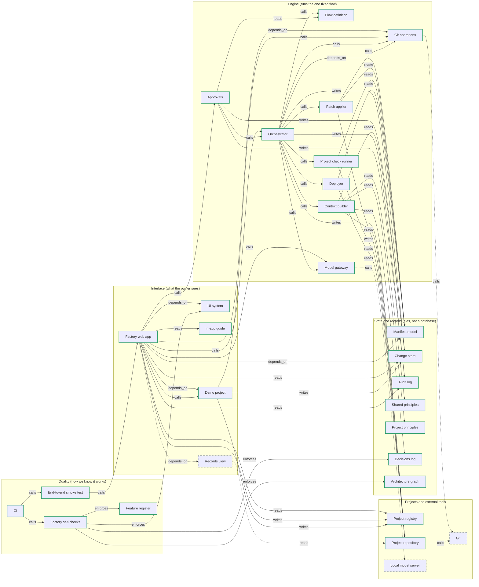

# Architecture graph

Generated from `graph.yaml` by `scripts/graph_check.py`. Do not edit by hand; regenerate with `python scripts/graph_check.py --write`.

Solid outline and solid arrow: exists today. Dashed: planned.

